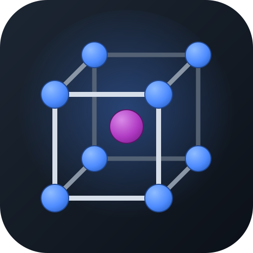

# LatticeLab

**Malzeme Biliminin Temelleri** için 3 boyutlu, etkileşimli bir öğrenme aracı.
Kristal yapıları, **Miller düzlemlerini (hkl)** ve **doğrultularını [uvw]** telefon,
tablet ve bilgisayarda görselleştirir; LAY/DAY/APF hesaplarını adım adım gösterir.

<br clear="left">

> Metalurji ve Malzeme Mühendisliği öğrencileri için hazırlanmıştır.
> Türkçe ve İngilizce dil desteği vardır.

---

## 📲 İndir ve Kur

Uygulamayı tarayıcıda hemen açabilir ya da Windows kurulumunu
**[Releases](../../releases/latest)** sayfasından indirebilirsin:

| Platform | Nasıl |
|---|---|
| **Tarayıcı** (her cihaz) | [ilhanyurek.github.io/LatticeLab](https://ilhanyurek.github.io/LatticeLab/) — kurulum gerekmez |
| **Windows** (PC) | `LatticeLab-Setup.exe` → indir → çalıştır → kur |

---

## ✨ Özellikler

**Kristal yapılar (3B, döndür–yakınlaştır):**
- **Saf metaller:** BK (Basit Kübik), HMK (HMK/BCC), YMK (YMK/FCC), HSP (HSP/HCP)
- **Bileşikler:** NaCl, CsCl, ZnS, CaF₂ 

**Miller indisleri:**
- **Düzlemler (hkl) / (hkil):** Negatif indiste orijin otomatik kaydırılır (kübik
  ve HSP); düzlemler arası mesafe (d) kübik ve HSP için gösterilir.
- **Doğrultular [uvw] / [uvtw]:** HSP 4-indis → 3-indis dönüşümü (U = u−t, V = v−t, W = w).
- Negatif indisler ders kitabındaki gibi **üst çizgiyle** yazılır: (1̄10).
- Ders kitabı yönelimi: **z (HSP'de c) yukarı**, x izleyiciye doğru, y sağa.

**Hesaplamalar (adım adım: formül, n, uzunluk/alan/hacim, sonuç; a ve r cinsinden):**
- **LAY** — Lineer Atom Yoğunluğu
- **DAY** — Düzlemsel Atom Yoğunluğu
- **APF/ADF** — Atomik Dolgu Faktörü

**Bileşiklerde:** tetrahedral / oktahedral / kübik **boşluk** ve **koordinasyon**
açıklamaları, Shannon iyon yarıçapları ve r<sub>katyon</sub>/r<sub>anyon</sub> oranı.
Dolu görünümde iyonlar gerçek oranlarıyla birbirine temas eder.

**Diğer:** top–çubuk (en yakın komşu bağları) / dolu (temas eden atom) görünümü,
atom/eksen/hücre aç-kapa, dokunmatik kontroller, ⚙ Ayarlar'da dil ve iletişim.

---

## 🧮 Doğruluk

LAY/DAY, atom sayımı tam sayı aritmetiğiyle yapılarak hesaplanır; bu nedenle
HSP gibi bazlı yapılarda ve atom içermeyen düzlemlerde de doğrudur (örn. BK (200)
için DAY = 0). Callister ile karşılaştırılan değerler:

| Yapı | Sonuç |
|---|---|
| YMK [110] | LAY = 0,500 / r |
| HMK [111] | LAY = 0,500 / r |
| YMK (111) | DAY = 0,289 / r² |
| YMK (110) | DAY = 0,177 / r² |
| HMK (110) | DAY = 0,265 / r² |
| HSP (0001) | DAY = 0,289 / r² |

---

## 🛠️ Geliştirme

```bash
npm install
npm run dev        # tarayıcıda geliştirme (http://localhost:5173)
npm run build      # web çıktısı -> dist/
```

**Teknoloji:** [Three.js](https://threejs.org) (3B) + [Vite](https://vitejs.dev)
(paketleme) + [Capacitor](https://capacitorjs.com) (Android) +
[Electron](https://electronjs.org) (Windows).

### Android APK derleme
> Android artık yayınlanmıyor. APK gerektiğinde Actions sekmesinden
> **Android APK (elle)** workflow'u çalıştırılarak üretilir; çıktı o koşunun
> artifact'ında olur. Yerelde derlemek için:

```bash
npm run build
npx cap sync android
cd android && ./gradlew assembleRelease
# Çıktı: android/app/build/outputs/apk/release/app-release.apk
```

### Windows .exe derleme
```bash
npm run electron:build      # dist-electron/ içine kurulum .exe'si üretir
```

### Otomatik yayın (GitHub Actions)
Commit mesajında **`[release]`** geçen bir push, Windows .exe derleyip
**GitHub Release**'e (`v1.0`) yükler. Bkz: `.github/workflows/release.yml`.

Tarayıcı sürümü ayrı yayınlanır: `main`'e her push'ta
`.github/workflows/pages.yml` çalışır.

---

## 🗺️ Yol Haritası
- Hume-Rothery kuralları (katı çözünürlük)
- Teorik yoğunluk (ρ) hesabı
- İndis ailesi gösterimi `{hkl}` / `⟨uvw⟩`

---

## 📬 İletişim
Soru, öneri ve hata bildirimi: **contact@ilhanyurek.com**
